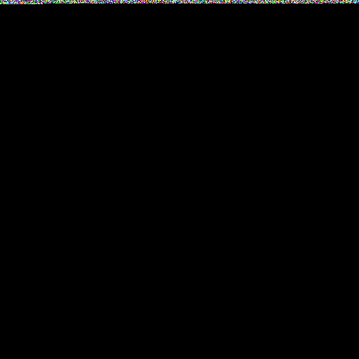
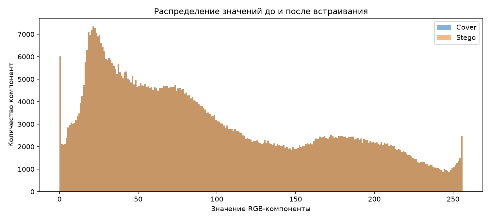

# Лабораторная работа №2. Стеганография, шифрование и статистический анализ

## 1. Постановка задачи

В работе сравниваются три способа сокрытия данных в RGB-изображении:

1. **Plain LSB** — открытый текст и последовательный порядок компонент;
2. **Encrypted LSB** — AES-GCM и последовательный порядок компонент;
3. **Encrypted Random LSB** — AES-GCM и воспроизводимый псевдослучайный порядок компонент.

В качестве исходных изображений использованы: `cover.png` (512×512 пикселей); `gradient.png` (512×512 пикселей).

## 2. Реализация

Текст преобразуется в UTF-8 и помещается в бинарный пакет с сигнатурой и длиной данных. Перед встраиванием проверяется вместимость изображения. Данные записываются в младшие биты RGB-компонент; при извлечении восстанавливается пакет и исходный текст.

Для зашифрованных режимов используется AES-256-GCM. Ключ получается из пароля с помощью PBKDF2-HMAC-SHA256; для пакета генерируются случайные salt и nonce. В режиме Random последовательность позиций воспроизводится по паролю, повторное использование позиций исключено.

## 3. Методика эксперимента

Основное сравнение выполнено для трёх методов на каждом изображении. Для всех методов в рамках одного изображения используется одинаковый размер пакета. Дополнительно на основном изображении сравниваются уровни заполнения 1% и 5%. Рассчитываются PSNR, SSIM, количество и доля изменённых компонент, распределение LSB, χ² и p-value. Для одного примера сохраняются карта разности и сравнительная гистограмма.

## 4. Результаты основного эксперимента

### Изображение `cover.png`

| Вариант | PSNR, dB | SSIM | Изменено компонент | Changed ratio | P(LSB=1) | χ² | p-value |
|---|---|---|---|---|---|---|---|
| Cover | — | — | 0 | 0.000% | 0.497271 | 2455.3678 | <1e-300 |
| Plain LSB | 71.152 | 0.999991 | 3922 | 0.499% | 0.496607 | 2456.2959 | <1e-300 |
| Encrypted LSB | 71.121 | 0.999991 | 3950 | 0.502% | 0.497447 | 2445.9929 | <1e-300 |
| Encrypted Random LSB | 71.162 | 0.999975 | 3913 | 0.498% | 0.497451 | 2400.2501 | <1e-300 |

### Изображение `gradient.png`

| Вариант | PSNR, dB | SSIM | Изменено компонент | Changed ratio | P(LSB=1) | χ² | p-value |
|---|---|---|---|---|---|---|---|
| Cover | — | — | 0 | 0.000% | 0.462207 | 52106.7563 | <1e-300 |
| Plain LSB | 71.293 | 0.999946 | 3797 | 0.483% | 0.463329 | 48397.4798 | <1e-300 |
| Encrypted LSB | 71.157 | 0.999938 | 3918 | 0.498% | 0.464030 | 47149.7456 | <1e-300 |
| Encrypted Random LSB | 71.071 | 0.999917 | 3996 | 0.508% | 0.462563 | 51089.9741 | <1e-300 |

## 5. Влияние объёма данных

| Вариант | Пакет, байт | Пакет, бит | PSNR, dB | SSIM | Изменено компонент | Changed ratio | P(LSB=1) | χ² | p-value |
|---|---|---|---|---|---|---|---|---|---|
| Plain LSB | 983 | 7864 | 71.152 | 0.999991 | 3922 | 0.499% | 0.496607 | 2456.2959 | <1e-300 |
| Encrypted LSB | 983 | 7864 | 71.106 | 0.999991 | 3964 | 0.504% | 0.497317 | 2447.5336 | <1e-300 |
| Encrypted Random LSB | 983 | 7864 | 71.119 | 0.999974 | 3952 | 0.503% | 0.497292 | 2398.6153 | <1e-300 |
| Plain LSB | 4915 | 39320 | 64.173 | 0.999883 | 19562 | 2.487% | 0.494273 | 2464.7583 | <1e-300 |
| Encrypted LSB | 4915 | 39320 | 64.138 | 0.999882 | 19720 | 2.508% | 0.497032 | 2431.1349 | <1e-300 |
| Encrypted Random LSB | 4915 | 39320 | 64.105 | 0.999872 | 19871 | 2.527% | 0.497148 | 2210.9949 | <1e-300 |

## 6. Визуализация

Карта разности для Plain LSB:

Сравнительная гистограмма значений RGB-компонент:

## 7. Анализ результатов

Для `cover.png` значения PSNR находятся в диапазоне 71.121–71.162 dB. Наибольшее значение получено у метода **Encrypted Random LSB**, наименьшее — у **Encrypted LSB**.

Значения SSIM для `cover.png` лежат в диапазоне 0.999975–0.999991.

Для `cover.png` χ² исходного Cover равен 2455.3678; отклонение χ² после встраивания относительно Cover составляет от -55.1177 до +0.9281.

Для `gradient.png` значения PSNR находятся в диапазоне 71.071–71.293 dB. Наибольшее значение получено у метода **Plain LSB**, наименьшее — у **Encrypted Random LSB**.

Значения SSIM для `gradient.png` лежат в диапазоне 0.999917–0.999946.

Для `gradient.png` χ² исходного Cover равен 52106.7563; отклонение χ² после встраивания относительно Cover составляет от -4957.0107 до -1016.7822.

При переходе от 1% к 5% средняя доля изменённых компонент по трём методам меняется с 0.502% до 2.507% (примерно в 5.00 раза).

Средний PSNR снижается с 71.126 dB при заполнении 1% до 64.139 dB при заполнении 5%.

Для исходных изображений и stego-вариантов p-value χ² может быть очень малым. Поэтому p-value нельзя трактовать как самостоятельный детектор факта встраивания: его нужно сопоставлять с результатом для исходного Cover того же изображения.

Шифрование защищает содержимое сообщения, но само по себе не гарантирует статистическую незаметность. Псевдослучайное размещение меняет позиции записи, однако его преимущество по PSNR, SSIM или χ² должно подтверждаться конкретными результатами эксперимента; универсально лучшего метода по всем метрикам может не быть.

## 8. Вывод

Реализованы три варианта LSB-встраивания и обратное извлечение сообщения. Для двух зашифрованных вариантов используется AES-GCM; третий метод дополнительно меняет порядок позиций на псевдослучайный. Полученные значения PSNR, SSIM, Changed ratio и χ² позволяют сравнить влияние методов на конкретные изображения. При увеличении объёма payload обычно увеличивается доля изменённых компонент и снижается PSNR. Статистические результаты необходимо интерпретировать с учётом характеристик исходного Cover.

## 9. Полученные файлы

- `imgs/stego_plain.png`, `imgs/stego_encrypted.png`, `imgs/stego_random.png` — результаты основного опыта;
- `results/metrics.csv` — основные статистические показатели;
- `results/payload_levels.csv` — сравнение уровней заполнения;
- `results/difference.png` — карта разности;
- `results/histogram.png` — сравнительная гистограмма.
